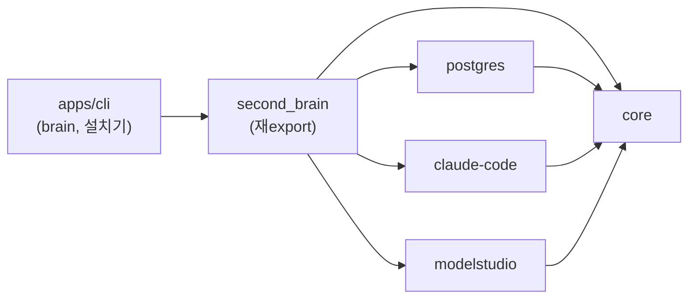
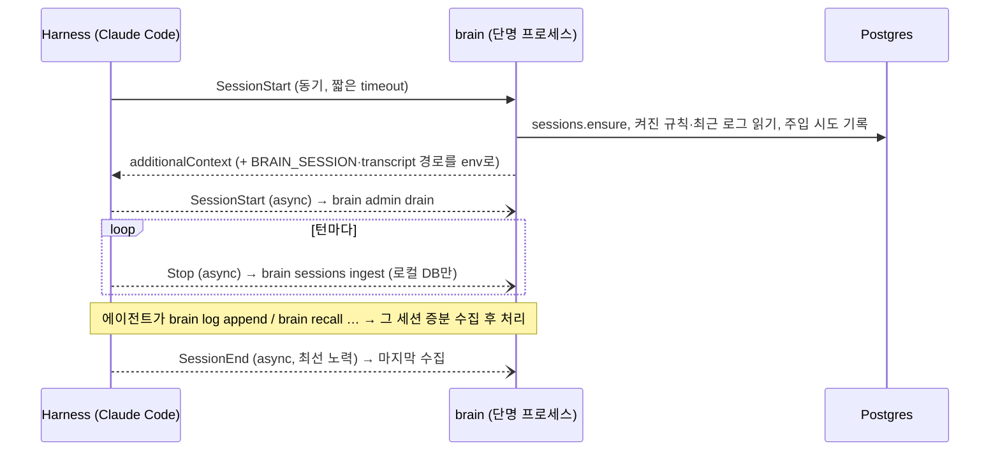
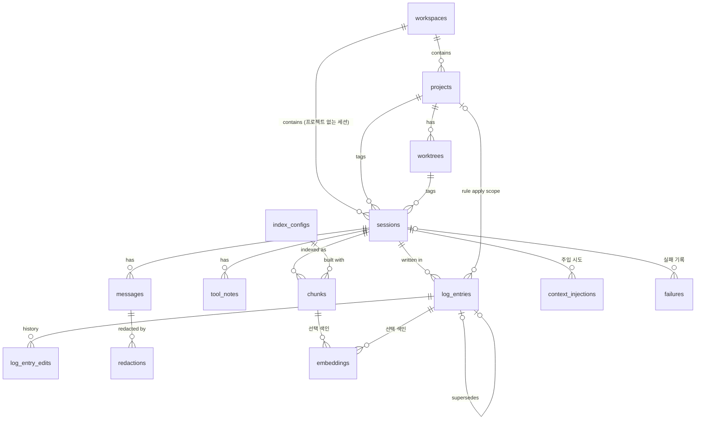
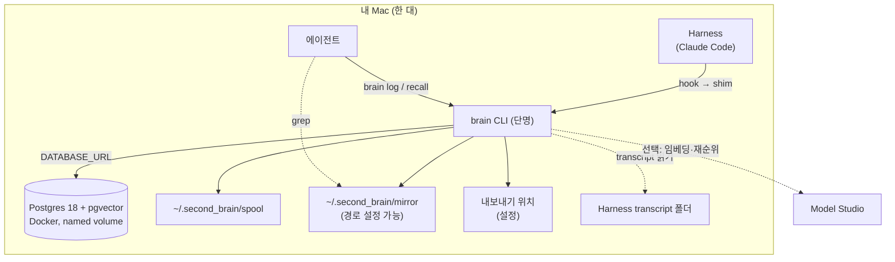

# Architecture Spine — Personal Brain V1 slice 1

## Design Paradigm

**Hexagonal (ports & adapters).** Core는 use case와 port만 정의하고 제품 이름을 모른다. adapter가 port를 구현하고, Runtime(CLI)이 명시적으로 조립한다. 상주 프로세스는 없다. 모든 실행은 짧게 떴다 사라지는 `brain` 프로세스이고, 같은 세션에 여러 프로세스가 동시에 뜨는 것을 전제한다.

| 층 | 위치 | 아는 것 |
| --- | --- | --- |
| Core (도메인 + use case + port) | `packages/core` | 외부 패키지 없음 |
| Adapter (port 구현) | `packages/postgres`, `packages/claude-code`, `packages/modelstudio` | `core` + 자기 제품 하나 |
| 묶음 (조립용 표면) | `packages/second_brain` | 위 전부. 재export만, 코드 없음 |
| Runtime (CLI·설치기·hook 진입점·설정·spool) | `apps/cli` | `second_brain` |



화살표는 허용되는 의존 방향이다. 역방향, adapter 간 의존, `core`의 외부 의존은 금지다.

## Invariants & Rules

### AD-1 — 패키지 경계로 의존 방향을 강제한다 [ADOPTED]

- **Binds:** all, FR-23
- **Prevents:** Core가 `pg`·HTTP 클라이언트·Harness 형식·시스템 시계에 묶이는 것
- **Rule:** pnpm workspace. `core`의 `package.json`에는 런타임 의존성이 없다. adapter는 `core`에만 의존하고 서로 의존하지 않는다. 경계는 lint가 아니라 패키지 의존성으로 지킨다. 현재 시각과 ID 생성도 Core의 port(`Clock`, `IdGen`)이고 Runtime이 구현을 넣는다.

### AD-2 — 배포는 git 저장소, 쓰는 표면은 `second_brain` 하나다

- **Binds:** FR-23, FR-25
- **Prevents:** 쓰는 쪽이 내부 패키지를 골라 조합하다 어긋나는 것, npm 이름 충돌
- **Rule:** npm에 발행하지 않는다. 설치 진입점은 공개 git 저장소(`npx github:<owner>/second-brain`)다. 내부 패키지는 비발행 workspace 패키지다. 코드에서 쓰는 모양은 `import { createBrain, postgresStore, … } from "second_brain"`이다.

### AD-3 — import 시 부작용이 없다

- **Binds:** all, NFR-3
- **Prevents:** 묶음 import만으로 키 누락·DB 다운에 프로세스가 죽는 것
- **Rule:** 모듈 최상단에서 DB 연결, 환경 변수 검사, 키 읽기, 네트워크 호출을 하지 않는다. 모두 factory(`createBrain`, `postgresStore` 등)를 호출할 때 일어난다.

### AD-4 — connector 계약: Core는 Harness 중립 입력만 받는다

- **Binds:** FR-1, FR-2, FR-3, FR-5, FR-17, FR-24
- **Prevents:** Harness 형식이 Core로 새는 것, 같은 transcript에서 수집할 때마다 다른 결과가 나오는 것
- **Rule:**
  - Core의 수집 입력은 `IngestBatch`(세션 키 + 추적 정보 + 메시지 + 도구 메모)다.
  - connector의 **필수 요소는 transcript parser 하나**다. 출력은 (transcript 내용, `parser_version`)의 순수 함수다. 메시지 `seq`와 도구 메모 순번도 parser가 정하고, 같은 입력이면 항상 같은 값이다.
  - parser 커서는 (마지막 Harness 메시지 ID, 그 지점까지의 fingerprint)다. 커서 메시지가 사라졌거나(compact·fork) fingerprint가 다르면 처음부터 다시 읽는다. 멱등이므로 중복은 생기지 않고, 경고를 남긴다.
  - parser 버그로 이미 저장된 메시지는 고치지 않는다(원문 불변 우선). 재수집은 빠진 것만 추가한다. 세션마다 `parser_version`을 기록한다.
  - **hook 입출력**(stdin 해석, `hookSpecificOutput`·`systemMessage` 형식, 세션 환경 변수 쓰기)은 connector adapter가 소유한다. CLI의 `--json` 봉투와는 별개인 세 번째 출력 모드다. hook 출력은 10,000자를 넘지 않는다.
  - hook과 세션 환경 변수는 **선택 요소**다. 없으면 다음 대체 경로로 동작한다.

| Brain이 필요한 것 | hook 있는 Harness | 없는 Harness |
| --- | --- | --- |
| 시작 맥락 | 시작 hook → `brain context` | 지시 파일 한 줄("세션 시작 시 `brain context` 실행"). 규칙 자체는 복사하지 않는다 |
| 수집 시점 | 턴 hook → `brain ingest` | `brain log`·`brain recall` 직전 증분 수집 + drain의 transcript 폴더 스캔 |
| 세션 식별 | 환경 변수 `BRAIN_SESSION` | 시작 맥락 문장의 세션 키 → `--session`. 없으면 spool에 두고 drain이 Harness·폴더·시각으로 연결 |

모델과 Harness는 별개 칸이다. 모델 이름은 메시지마다 기록되고 동작을 바꾸지 않는다.

### AD-5 — CLI는 SDK를 부르는 얇은 껍데기다

- **Binds:** FR-23, FR-24
- **Prevents:** 진입점마다 동작이 갈리는 것, 데몬·MCP 도입 시 재작성
- **Rule:** CLI 명령에는 인자 해석과 출력 형식 변환 외의 로직이 없다. SDK 메서드 `<ns>.<verb>`는 CLI `brain <ns> <verb>`, (미래의) MCP 도구 `<ns>_<verb>`와 같은 입출력 형태를 1:1로 갖는다. 출력은 `--json`(에이전트용)과 텍스트(사람용) 두 가지다. slice 1은 CLI만 내고, 표면은 아래 표로 고정한다.

| ns | verb | 하는 일 (FR) |
| --- | --- | --- |
| `context` | `show` | 시작 맥락 출력 (17) |
| `sessions` | `ingest`, `list`, `read`, `assign-workspace`, `failures`, `retry` | 수집, 목록(로그 없는 세션 포함), 넓히기(메시지·도구 메모), 워크스페이스 넣기, 실패 조회·다시 수집 (1~6, 9, 15) |
| `log` | `append`, `list`, `edit`, `set-state`, `set-scope` | 적기, 조회(종류·꼬리표·기간), 고치기, 끄기·켜기, 규칙 적용 범위 (7, 8, 19~22) |
| `recall` | `time`, `logs`, `chunks`, `tools`, `expand` | 시간 조회, 대분류, 소분류, 도구 메모 검색, 앞뒤 조각 (12~16) |
| `messages` | `redact` | 비밀 가리기 (AD-11) |
| `admin` | `drain`, `doctor`, `export`, `import`, `reindex`, `mirror-rebuild` | 밀린 일, 점검, 내보내기·복구, 재색인, 미러 재생성 (5, 11, 25, NFR-9) |
| `setup` | `run`, `connect`, `upgrade`, `uninstall` | 설치·재설정, Harness 연결, 업그레이드, 제거 (AD-19, AD-20) |

### AD-6 — 수명 주기 매핑

- **Binds:** FR-1, FR-5, FR-7, FR-8, FR-10, FR-17, FR-18, NFR-3, NFR-7
- **Prevents:** 비정상 종료 세션 유실, Harness가 수집을 기다리는 것, 정확성이 종료 hook에 의존하는 것
- **Rule:** 아래 매핑을 따른다.
  - 동기 경로(시작 hook)에는 네트워크 호출이 없다.
  - **정확성은 `SessionEnd`에 의존하지 않는다.** 종료 hook은 최선 노력이고, 놓친 일은 drain이 한다.
  - `brain log`와 `brain recall`은 connector가 transcript를 찾을 수 있으면 그 세션을 먼저 증분 수집한다.



### AD-7 — 동시성: 세션 잠금과 drain

- **Binds:** FR-5, FR-8, FR-11, FR-19, NFR-2
- **Prevents:** 같은 세션의 겹친 수집이 seq를 충돌시키거나 조용히 사라지는 것, Harness마다 재시도를 다시 만드는 것
- **Rule:**
  - 한 세션의 데이터를 쓰는 모든 경로(수집, 미러 쓰기, 로그 연결)는 그 세션의 Postgres advisory 잠금을 트랜잭션 안에서 잡는다. 커서 전진과 배치 삽입은 같은 트랜잭션이다.
  - 밀린 일(실패한 수집, transcript 폴더 스캔, 조각·색인 생성, 규칙 인용 대조, 로그-메시지 연결, spool 재주입, 미러 갱신)은 SDK의 `admin.drain()` 하나가 처리한다. 호출자는 시작 hook(async)과 `brain admin doctor`다.
  - drain은 동시 실행을 전제하고, 일감은 `FOR UPDATE SKIP LOCKED`로 나눠 가진다. 모든 백그라운드 작업은 멱등이다.

### AD-8 — ID와 멱등 키

- **Binds:** FR-5, FR-7, NFR-9
- **Prevents:** 재수집·spool 재주입·복구·겹친 실행에서 생기는 중복(불변 trigger 때문에 중복은 지울 수 없다)
- **Rule:**
  - 모든 레코드 ID는 생성하는 쪽이 UUIDv7로 정한다(`IdGen` port). DB 생성 ID는 쓰지 않는다.
  - 테이블마다 자연 멱등 키를 UNIQUE 제약으로 둔다(키는 Table Contract 참고).
  - 프로세스 경계를 넘는 세션 토큰은 `harness:harness_session_id` 문자열뿐이다. Brain 내부 UUID는 프로세스 밖으로 나가지 않는다.
  - 계약 테스트에 "같은 배치를 두 번 넣으면 모든 테이블의 건수가 같다"를 넣는다.

### AD-9 — DB에 못 쓴 것은 spool에 쌓는다

- **Binds:** FR-5, FR-7, FR-17, NFR-2, NFR-3
- **Prevents:** DB 다운 중 작업 로그 유실(transcript로 복구할 수 없는 유일한 쓰기), spool 파일의 섞임·유실
- **Rule:**
  - DB에 쓰지 못한 작업 로그 원문, 실패 기록, 수집 밀림 표시, 주입 시도 기록은 spool에 쓴다.
  - spool은 `~/.second_brain/spool/`의 **프로세스별 새 파일**(JSON Lines, 줄마다 `schema_version`)이다. 파일을 공유해 append하지 않는다.
  - drain은 파일을 `*.claiming`으로 rename한 뒤 재주입하고, 성공하면 지운다.
  - 레코드의 `occurred_at`과 ID는 처음 만든 프로세스가 정하고, 재주입 때 바꾸지 않는다.
  - DB 연결 불가는 다음처럼 드러낸다.
    - 시작 hook: 시작 맥락 대신 "연결 불가, 로컬 보관 N건"을 에이전트와 사용자(`systemMessage`)에게 보인다.
    - `brain log append`: 실패가 아니라 경고 `SPOOLED`와 함께 성공으로 답한다.
    - `brain admin doctor`: spool 건수와 가장 오래된 시각을 보인다.
    - 턴 수집 실패는 화면에 띄우지 않는다.

### AD-10 — 원본은 Postgres 하나다

- **Binds:** FR-1, FR-11, FR-23, FR-25, NFR-1, NFR-6, NFR-9
- **Prevents:** 원본이 둘이 되어 갈라지는 것, 호스팅 방식이 코드에 새는 것
- **Rule:**
  - 원본(SOT)은 Postgres다. Markdown 미러, 조각, 색인은 원본에서 다시 만들 수 있는 파생물이고, spool은 대기열이다.
  - Store port의 모든 구현은 하나의 공통 계약 테스트를 통과한다.
  - Core와 런타임 경로는 `DATABASE_URL` 하나로만 접근하고, Postgres를 띄우거나 설치하지 않는다. DB 생성은 설치기에만 있다(AD-19).

### AD-11 — 원문 불변, 그리고 유일한 예외인 가리기

- **Binds:** FR-1, FR-20, FR-21, FR-22, FR-26, NFR-1
- **Prevents:** 코드 실수로 원문이 바뀌는 것, 비밀이 영구히 남는 것, 작업 로그의 현재 문장 위치가 단위마다 달라지는 것
- **Rule:**
  - **저장 전 마스킹**: 수집은 알려진 비밀 패턴(API 키, 토큰, 개인 키, `password=` 류)을 `[REDACTED:<kind>]`로 바꾼 뒤 저장한다. 패턴 목록은 Core에 하나만 둔다.
  - `messages`와 `tool_notes`는 UPDATE·DELETE를 거부하는 DB trigger를 가진다. **유일한 예외는 `messages.redact`**다. 이 함수는 본문 일부나 전체를 `[REDACTED:<kind>]`로 바꾸고, 같은 트랜잭션에서 `redactions`에 위치·종류·지운 내용의 해시만 남긴다(지운 내용은 보존하지 않는다). trigger는 이 경로만 통과시킨다. 가린 세션의 미러는 다시 만든다.
  - 작업 로그의 현재 문장은 `log_entries` 행에 있다. 수정은 `log.edit` 하나만 하고, 같은 트랜잭션에서 이전 문장을 `log_entry_edits`에 남긴다.
  - 결정·선호의 대체는 수정이 아니라 새 행 + `supersedes_id`다.

### AD-12 — 세션 생성, 꼬리표, 정체성

- **Binds:** FR-3, FR-4, FR-19, NFR-8
- **Prevents:** 같은 세션이 두 행이 되는 것, 꼬리표의 두 번째 진실, 사람·기계마다 같은 레포가 다른 프로젝트로 갈라지는 것
- **Rule:**
  - 세션 행은 `sessions.ensure(harness, harness_session_id)` 하나만 만든다(find-or-create, 같은 잠금 안에서). 세션 키를 모르는 쓰기는 행을 만들지 않고 spool로 간다.
  - 꼬리표(워크스페이스·프로젝트·워크트리)는 `sessions`에만 둔다. 로그와 조각은 `session_id`로 따라간다. [ADOPTED]
  - 꼬리표는 세션을 만드는 쪽이 cwd로부터 **한 번** 계산한다(시작 hook이면 hook 입력, 수집이면 transcript의 cwd). 이후 사람이 하는 워크스페이스 지정 외에는 바뀌지 않는다.
  - 프로젝트 정체성은 Core의 정규화 함수 하나가 정한다: git remote URL을 `host/owner/repo`(소문자 host, scheme·사용자·포트·`.git` 제거, ssh와 https 동일)로 만든다. remote가 없을 때만 로컬 git 공통 디렉터리를 쓴다. 워크트리는 (프로젝트, 작업 폴더 경로)이고 폴더가 지워져도 행은 남는다.
  - 세션에는 사용자 식별자(설정값)와 기계 이름이 있다. slice 1에서 사용자는 항상 나다.
  - **규칙의 적용 범위는 꼬리표가 아니라 규칙의 속성이다**(`apply_project_id`). 이것이 "꼬리표는 세션에만"의 유일한 예외다.

### AD-13 — 시각은 절대 시각뿐이다

- **Binds:** FR-6, FR-12, FR-17
- **Prevents:** Core 안의 자연어 날짜 해석기, 에이전트가 오늘을 잘못 아는 것, 재주입이 시각을 바꾸는 것
- **Rule:**
  - 저장·입력·출력은 모두 `timestamptz` 절대 시각이다. "어제·지난주" 변환은 에이전트 몫이고 Brain은 절대 범위만 받는다.
  - 발생 시각(`occurred_at`)은 사건이 일어난 프로세스가 `Clock` port로 한 번 정한다. DB에 들어간 시각은 `recorded_at`으로 따로 둔다.
  - 시작 맥락에는 오늘 날짜와 시간대(설정, 기본 `Asia/Seoul`) 한 줄이 들어간다. 모든 `--json` 응답은 `now`와, 받은 범위를 되울린다.

### AD-14 — 작업 로그의 작성자, 대화 연결, 규칙 상태

- **Binds:** FR-7, FR-8, FR-9, FR-19
- **Prevents:** 자동 경로가 로그를 써서 SM-4가 오염되는 것, 로그가 엉뚱한 대화에 붙는 것, 다시 쓴 규칙이 켜지거나 내가 끈 규칙이 되살아나는 것
- **Rule:**
  - **작업 로그는 에이전트(또는 나)가 `log.append`로만 만든다.** hook, 수집, drain은 로그 행을 만들지 않는다. 쓰기 API는 둘이다: 대화 쌓기(`sessions.ingest`)와 로그 쌓기(`log.append`).
  - 로그는 `occurred_at` 직전의 메시지(`seq`가 가장 큰, `occurred_at` 이하인 메시지)에 이어진다. 연결 결과(`anchor_seq`)와 연결할 때까지 본 메시지 범위(`joined_upto_seq`)를 함께 기록한다. 더 이른 메시지가 나중에 들어오면 drain이 같은 식으로 다시 잇는다.
  - 규칙 상태는 `pending | on | off`다. `pending`은 주입하지 않는다. `log.append`와 drain은 `pending`만 `on`으로 바꿀 수 있고, `off`는 사람의 `log.set-state`만 정한다.
  - 인용 대조는 저장된 본문과 인용을 **양쪽 다 NFC로 정규화해서** 비교한다. 위치는 저장된 본문 위의 **코드 포인트 반열린 구간** `[start, end)`다. 위치 없이 받은 인용은 본문에서 한 군데에만 맞을 때 성공한다. 대조가 끝내 실패한 규칙은 `pending`으로 남고 점검에 올라간다.

### AD-15 — 검색: 키워드가 기본, 임베딩은 선택 색인

- **Binds:** FR-2, FR-10, FR-11, FR-13, FR-14, FR-16, FR-25, NFR-2, NFR-4, NFR-6
- **Prevents:** 기본 구성에서 소분류 검색이 빈 결과를 성공으로 돌려주는 것, 색인 설정이 섞인 검색, 결과 형태가 단위마다 달라지는 것
- **Rule:**
  - **조각은 항상 만든다.** 조각 규칙(목표 1,200자, 메시지 경계, 인접 겹침 1메시지, 2,400자 넘는 메시지는 분할, 머리말 없음)은 `index_configs`에 기록된 값을 따른다.
  - 기본 검색은 키워드다. `chunks.body`, `log_entries.text`, `tool_notes.target`에 대한 `ILIKE` + `pg_trgm` GIN 인덱스를 쓴다. 3글자 미만 질의는 인덱스 없이 순차 검색한다(개인 규모에서 허용).
  - 한국어·영어 교차는 에이전트가 질의를 바꿔 다시 찾는 것으로 충족한다. 그 방법은 시작 맥락 안내에 넣는다.
  - 임베딩·재순위는 port 뒤의 선택 색인이고 **slice 1 기본값은 꺼짐**이다. 켜는 경우:
    - 차원은 설정 시점에 고정하고(`vector(1024)`, 2,000 초과는 `halfvec`) HNSW 인덱스를 처음부터 건다.
    - 사용 중인 색인 설정은 DB에 기록하고, 설정 파일과 다르면 경고 `INDEX_CONFIG_MISMATCH`를 낸다.
    - 모델·차원 변경은 `admin.reindex`가 새 테이블을 만든 뒤 교체한다. 교체 전까지는 옛 테이블로 검색한다.
    - 재순위가 실패하면 벡터 순위를 그대로 돌려주고 경고 `RERANK_FAILED`를 낸다.
  - **결과 계약**: 결과마다 출처(`session` 토큰, `harness`, 날짜, 꼬리표, `seq_from`·`seq_to`, `chunk_id` 또는 `log_entry_id`)를 붙인다. 이 출처가 곧 `recall.expand`·`sessions.read`의 입력이다.
  - 정렬은 근접 단계(같은 워크트리 → 프로젝트 → 워크스페이스 → 전체) 다음 관련도 순이다.
  - 한 번의 결과는 기본 5건, 총 8,000자 이하다. Brain이 자르고 경고 `RESULT_TRUNCATED`를 낸다.

### AD-16 — Markdown 미러는 DB에서 파일로만 간다

- **Binds:** FR-15, FR-24, NFR-6, NFR-9
- **Prevents:** 미러가 두 번째 원본이 되는 것, 증분 쓰기와 재생성이 같은 파일에서 부딪치는 것
- **Rule:**
  - 세션당 파일 하나다. 파일 이름은 `YYYY-MM-DD_<harness>_<project>_<session 토큰 뒤 12자>.md`이고, 내용은 그 세션의 DB 상태만으로 정해지는 순수 함수다(frontmatter + 메시지 + 도구 메모).
  - 쓰기는 항상 전체 교체(임시 파일 → rename)이고, 세션 잠금(AD-7) 안에서 한다. 증분 갱신과 `admin.mirror-rebuild`는 같은 함수를 쓴다. 실패는 실패 기록에 남는다.
  - 미러를 읽어 DB에 쓰는 경로는 없다. 경로는 설정 한 줄(기본 `~/.second_brain/mirror/`)이고, Brain은 그 폴더가 동기화 폴더인지 모른다.

### AD-17 — 시작 맥락: 규율의 원본, 크기, 기록

- **Binds:** FR-7, FR-14, FR-17, FR-18, FR-19, NFR-2
- **Prevents:** Harness마다 규율이나 규칙 사본이 갈라지는 것, 주입이 조용히 실패하는 것, 토크나이저에 의존하는 것
- **Rule:**
  - "언제 작업 로그를 적는가", "못 찾으면 질의를 바꿔 다시 찾는다" 안내와 켜진 규칙은 Brain의 시작 맥락으로만 나간다. skill, plugin, AGENTS.md, CLAUDE.md에는 "Brain을 써서 찾고 적어라" 이상을 넣지 않는다.
  - 구성은 오늘 날짜·시간대, 켜진 규칙(어디서나 + 현재 프로젝트), 최근 작업 로그, 사용 안내다. 선호는 넣지 않는다.
  - 크기는 **글자 수**로 잰다(토크나이저 없음). 최근 로그 부분과 규칙 경고선은 설정값이고, 전체는 hook 상한 10,000자 안이다. 최근 로그는 오래된 줄부터 빼고, 규칙은 전부 넣되 경고선을 넘으면 점검에 경고한다.
  - 주입 시도는 성공·실패를 모두 `context_injections`에 기록한다(DB가 없으면 spool). doctor는 "세션 수 대비 주입 시도 수"를 보인다.

### AD-18 — 설정과 키는 저장소 밖 한 곳에서 읽는다

- **Binds:** FR-25, NFR-6
- **Prevents:** 키가 공개 저장소로 들어오는 것, 설정을 읽는 곳이 흩어지는 것, 모르는 설정이 조용히 기본값으로 떨어지는 것
- **Rule:**
  - 설정은 `~/.second_brain/config.toml`(`schema_version` 포함), 키는 `~/.second_brain/.env`에 둔다. 설정 파일에는 키 값이 아니라 환경 변수 이름만 적는다.
  - 읽기·쓰기는 Runtime의 설정 코덱 하나만 한다(설치기 포함). 모르는 키는 경고하고, Core에는 값으로 넘긴다.

### AD-19 — 설치기와 Harness 연결

- **Binds:** FR-17, FR-24, FR-25
- **Prevents:** 설정을 건너뛴 반쪽 설치, hook 이중 등록, Node 경로가 바뀌어 수집이 조용히 멈추는 것
- **Rule:**
  - 설치는 대화형 설치기 하나다. 다음 순서로 묻고 진행한다.
    1. 환경 확인
    2. 빠진 의존성(Docker 등)은 설치를 묻고 동의하면 설치한다. 불가능하면 안내한다.
    3. DB: 기존 URL에 연결하거나, 동의 후 로컬 Docker로 만든다(`pgvector/pgvector:pg18`, named volume, `restart unless-stopped`).
    4. 미러 경로
    5. 임베딩(기본 아니오)
    6. 감지된 Harness 중 체크한 것을 연결한다.
    7. doctor
  - 재설정은 `brain setup run`이다. 같은 흐름을 멱등으로 돌리고, 현재 값을 기본값으로 보여 준다.
  - Harness 설정 파일을 쓰는 것은 connector의 `setup.connect` 하나다(설치기·재설정도 이것을 부른다). 등록한 항목에는 Brain 표식을 달고, 그 표식으로만 "이미 있음"을 판정한다.
  - hook은 설치기가 만든 고정 shim(`~/.second_brain/bin/brain`)을 부른다. shim은 설치 시점의 node 절대 경로를 담는다. `npx`는 부르지 않는다.
  - doctor는 shim과 node 경로의 실존, Harness별 마지막 hook 수신 시각을 검사한다.

### AD-20 — 운영: 스키마 버전, 업그레이드, 백업, 제거

- **Binds:** FR-25, NFR-2, NFR-9
- **Prevents:** 코드와 스키마 버전이 어긋난 채 조용히 쓰는 것, 기억이 기계와 함께 사라지는 것, 흔적이 남는 제거
- **Rule:**
  - DB는 `schema_version`을 가진다. **마이그레이션은 `setup run`과 `setup upgrade`만 실행**한다.
  - 런타임 명령은 시작할 때 버전을 확인한다. 다르면 DB에 쓰지 않고 spool로 보내며, 경고 `SCHEMA_MISMATCH`와 함께 doctor에 올린다.
  - `setup upgrade`는 코드 갱신 → 빌드 → 마이그레이션 → shim·hook 재등록 → doctor 순서다.
  - 백업은 `admin.export`다. 내보내기 위치는 설정이고, doctor는 마지막 내보내기가 설정한 기간(기본 7일)보다 오래되면 경고한다.
  - `setup uninstall`은 Brain 표식이 붙은 hook과 shim을 지운다. DB와 데이터 폴더는 별도의 명시적 확인을 받아야 지운다.

## Table Contract

Table Contract는 컬럼 전체가 아니라 단위 사이에 걸리는 키, 작성자, 변경 가능성만 고정한다. 나머지 컬럼은 코드가 정한다.

| 테이블 | 멱등 키 (UNIQUE) | 작성자 | 변경 가능성 |
| --- | --- | --- | --- |
| `projects` | `remote_identity` | `sessions.ensure` (find-or-create) | `workspace_id`만 사람이 바꿈 |
| `worktrees` | `(project_id, path)` | `sessions.ensure` | `removed_at`만 drain이 채움 |
| `workspaces` | `name` | 사람(`sessions.assign-workspace`) | 이름 변경 |
| `sessions` | `(harness, harness_session_id)` | 생성: `sessions.ensure`. 갱신: `sessions.ingest` | 불변: 키, `user_id`, `machine`, `started_at`, 꼬리표, `ingest_source(live\|import)`. 단조: `ended_at`, 커서(`last_harness_message_id`, fingerprint), `parser_version`, `ingested_at`. 변경 가능: `workspace_id`(사람), `start_source(startup\|resume\|clear\|compact\|fork)`, `continued_from_session_id`(예약, slice 1은 채우지 않음) |
| `messages` | `(session_id, harness_message_id)`, `(session_id, seq)` | `sessions.ingest` | 불변(예외: `messages.redact`). `occurred_at`은 원래 발화 시각 |
| `tool_notes` | `(session_id, harness_message_id, ordinal)` | `sessions.ingest` | 불변 |
| `log_entries` | `id`(작성 프로세스가 정한 UUIDv7) | 생성: `log.append`. 문장: `log.edit`. 상태·범위: `log.set-state`, `log.set-scope`. 연결·`pending→on`: drain·`log.append` | `kind`, `session_id`, `occurred_at`, `author_model` 불변 |
| `log_entry_edits` | `id` | `log.edit` | 불변 |
| `chunks` | `(session_id, index_config_id, seq_from, seq_to)` | drain | 파생, 다시 만들 수 있음 |
| `embeddings` | `(target_kind, target_id, index_config_id)` | drain | 파생 |
| `index_configs` | `(kind, model, dimensions, chunk_params)` | `setup run`, `admin.reindex` | 불변 |
| `redactions` | `id` | `messages.redact`, 수집의 저장 전 마스킹 | 불변 |
| `context_injections` | `id` | `context.show` | 불변 |
| `failures` | `(harness, harness_session_id, stage, fingerprint)`. `session_id`는 비어 있을 수 있음 | 모든 경로(실패 기록 함수 하나) | `resolved_at`만 drain이 채움 |
| `transcript_files` | `(harness, path)` | drain(폴더 스캔) | 크기·fingerprint·커서 단조 |
| `schema_version` | 단일 행 | `setup run`, `setup upgrade` | 마이그레이션만 |



## Consistency Conventions

| Concern | Convention |
| --- | --- |
| 이름 | DB 테이블·컬럼은 `snake_case` 복수형. TS 타입은 `PascalCase`, 함수·필드는 `camelCase`. SDK `<ns>.<verb>` ↔ CLI `brain <ns> <verb>` ↔ MCP `<ns>_<verb>` |
| ID | UUIDv7, Postgres `uuid`, JSON에서는 문자열. 프로세스 경계를 넘는 세션 토큰은 `harness:harness_session_id` |
| 시각 | DB `timestamptz`. JSON은 오프셋을 포함한 ISO-8601. 사람용 출력만 설정 시간대로 표시 |
| 텍스트 | 저장 본문은 Harness가 준 그대로(마스킹 제외). 비교·대조는 NFC 정규화 후. 위치는 코드 포인트 `[start, end)` |
| CLI `--json` 응답 | `{ ok, now, data, warnings[], error? }`. `error`는 `{ code, message }`. 저하된 결과는 반드시 `warnings[]`에 코드로 넣는다: `SPOOLED`, `DB_UNAVAILABLE`, `SCHEMA_MISMATCH`, `RERANK_FAILED`, `INDEX_CONFIG_MISMATCH`, `UNINDEXED`, `RESULT_TRUNCATED`, `RULE_UNVERIFIED`, `CURSOR_RESET` |
| hook 응답 | connector adapter 소유(AD-4). 10,000자 이하. hook 경로는 항상 exit 0으로 끝낸다(Stop의 exit 2는 턴을 이어 가게 하므로 금지) |
| 오류 | Core는 예상된 실패를 코드가 있는 값으로 돌려주고, 예외는 버그에만 쓴다. 실패는 `failures`에, DB가 없으면 spool에 남긴다. stderr만으로 끝내지 않는다 |
| 내보내기 (NFR-9) | 한 스냅샷 트랜잭션 안에서 테이블당 JSON Lines 하나 + `manifest.json`(스키마 버전, 테이블별 건수, 시각). 복구는 의존 순서대로 insert하고, 파생 테이블은 다시 만든다 |
| 마이그레이션 | SQL 파일, 순번 접두사, 앞으로만. trigger·확장·인덱스도 SQL로. trigger와 `redactions`·마스킹은 첫 마이그레이션에 함께 들어간다 |
| 테스트 | port마다 계약 테스트 묶음 하나, 모든 adapter가 통과. Postgres는 실제 DB(테스트 전용 데이터베이스)로 통합 테스트하고 mock하지 않는다. parser는 회사 내용을 지운 실제 transcript fixture로 테스트한다 |
| 공개 저장소 위생 | 저장소에는 회사 이름·내용·실제 대화를 넣지 않는다. 예시와 fixture는 중립 이름을 쓴다 |

## Stack

| Name | Version |
| --- | --- |
| Node.js | `>=24` LTS (24.21.0. 2026-10-28부터 26이 Active LTS) |
| TypeScript | 7.0.x (7.0.2) |
| pnpm (workspace) | 12.10.1 |
| PostgreSQL | 18 |
| pgvector (확장) | 0.8.7 |
| Docker 이미지 (설치기 기본값) | `pgvector/pgvector:pg18` |
| Kysely + `pg` | 0.29.6 / 8.23.1 |
| commander (CLI) | 15.0.0 |
| @clack/prompts (설치기) | 1.8.1 |
| smol-toml (설정) | 1.9.0 |
| uuid (v7) | 14.0.2 |
| vitest | 5.0.3 |
| 임베딩·재순위 (선택) | Model Studio `qwen3.7-text-embedding`(1024) / `qwen3-rerank` |

pgvector 연산은 Kysely의 `sql` 템플릿으로 직접 쓴다(`pgvector` npm 패키지는 쓰지 않는다).

## Structural Seed

```text
second-brain/
  packages/
    core/          # 도메인 타입, use case, port(Store, Parser, Embedder, Reranker, Clock, IdGen), 정규화·마스킹 함수, 계약 테스트
    postgres/      # Store port 구현, SQL 마이그레이션, trigger
    claude-code/   # transcript parser, hook 입출력, setup.connect
    modelstudio/   # 임베딩·재순위 port 구현 (선택 색인)
    second_brain/  # 묶음: 재export만
  apps/
    cli/           # brain 명령, 대화형 설치기, 설정 코덱, spool, shim 생성
```



## Capability → Architecture Map

| Capability / Area | Lives in | Governed by |
| --- | --- | --- |
| 세션 수집 (FR-1~6) | core `sessions` + claude-code parser + postgres | AD-4, AD-6, AD-7, AD-8, AD-11, AD-12, Table Contract |
| 작업 로그 (FR-7~9) | core `log` | AD-6, AD-9, AD-14, AD-17 |
| 색인 (FR-10~11) | core `index`(drain) + postgres(`pg_trgm`) + modelstudio(선택) | AD-7, AD-15 |
| 조회 (FR-12~16) | core `recall`, 미러 | AD-13, AD-15, AD-16 |
| 시작 맥락 (FR-17~18) | core `context` + connector hook 입출력 | AD-4, AD-6, AD-9, AD-13, AD-17 |
| 규칙·결정·선호 (FR-19~22) | core `log` + postgres trigger | AD-11, AD-12, AD-14 |
| SDK·도구·설정 (FR-23~25) | second_brain, apps/cli, 설치기 | AD-1, AD-2, AD-3, AD-5, AD-18, AD-19, AD-20 |
| 원문 불변·가리기 (NFR-1, FR-26) | postgres trigger, `messages.redact` | AD-11 |
| 조용한 실패 금지 (NFR-2) | `warnings[]`, `failures`, spool, `context_injections`, doctor | AD-7, AD-9, AD-15, AD-17, AD-20, Conventions |
| Harness 비차단 (NFR-3) | async hook, exit 0, import 부작용 없음 | AD-3, AD-6 |
| 비용·LLM 미호출 (NFR-5) | Core에 LLM port 없음, 임베딩 기본 꺼짐 | AD-1, AD-15 |
| 지연 (NFR-7) | 동기 경로는 로컬 DB만 | AD-6. 목표 수치는 PRD 갱신 대상 |
| 영속성 (NFR-9) | 내보내기·복구 | AD-8, AD-20, Conventions |

## Deferred

| 항목 | 미루는 이유 / 다시 볼 때 |
| --- | --- |
| MCP 도구 | Claude Code가 MCP에 세션 ID를 넘기지 않음. AD-5의 1:1 이름 규칙으로 나중에 얇게 붙인다 |
| 데몬·파일 watcher | 세션 없이 돌아야 할 일(스케줄러, 알림), 원격 기계 push, 또는 실측 지연이 목표를 못 맞출 때. CLI가 소켓이 있으면 위임하는 식으로 바뀐다 |
| Codex 등 다른 Harness | 다음 조각. AD-4의 계약(parser 필수, hook 선택)만으로 추가한다 |
| 팀 공유 (원문 포함) | 개인 사용을 먼저 검증한 뒤. 팀 저장소 선택(공유 드라이브 동기화 폴더 / 공유 DB / 회사 git)과 단계적 도입은 그때 정한다. AD-12의 remote 정체성·사용자 칸과 AD-11의 마스킹이 그 준비다 |
| Claude Code plugin·skill, BMad memlog 연계, 기록 보강 수단 | SM-4(로그가 실제로 적히는가) 결과를 본 뒤. 어떤 수단도 AD-17을 넘지 않는다 |
| 임베딩 기본 켜기 | 실사용 채점(SM-3)에서 키워드 검색과 질의 바꾸기로 "왜"나 한영 교차 질문을 놓칠 때 |
| parser 버그로 저장된 메시지의 교정 | 원문 불변과 충돌. 필요해지면 세션 단위 수집 세대 교체를 별도 결정으로 |
| 이어받은 세션 자동 연결, Execution 분리 | `continued_from_session_id`·`start_source` 자리만 둔다. 한 작업에 Harness 둘이 올 때 |
| 과거 세션 가져오기, LLM 세션 요약 | PRD §6.2·§8-1 그대로. `ingest_source`가 자리다 |
| Keychain 등 키 저장소 | `.env`로 시작. 설정 코덱 한 곳만 바꾸면 된다(AD-18) |
| 두 번째 기계 | `machine` 칸과 멱등 키로 수용. 연결 방식은 그때 |
