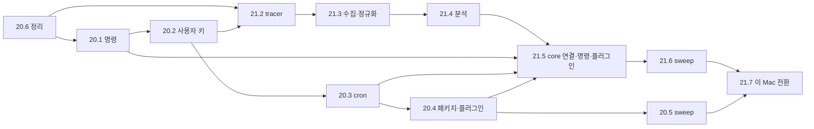

# Garmin 확장 재설계 — 기존 작업 처분과 이행 순서

2026-11-04~05 사용자 결정의 이행 지도다. 불변식은 spine의 AD가 정하고, 이 문서는 이미 만든 것을 어디에 쓰고 무엇을 멈출지와 그 순서를 적는다. 근거 조사는 sources의 연구 문서(기준 `93055d5`, 옛 Garmin `7fb33dd`)다.

## 전제 사실

- 운영 DB에 실제 Garmin 반입·수집 기록은 없다(14.8·16.9 blocked, 16.9 plan "운영 DB 반입 기록 0건"). core 건강 표·`analyses`의 Garmin 부분에는 합성 시험 데이터만 있었다. core에서 되돌려 옮길 데이터는 없다.
- epic 16의 정규화는 옛 `day_summary`·`workout`·`exercise_log`를 `garmin` 표로 만들지 않고 core `health_observations`에 지표 행으로 쓴다. 옛 반입 행은 `garmin.preserved_rows`에 원형 보존만 된다.
- 옛 프로그램은 Python 23개 파일 11,071행, DB 실행 호출 10개 파일 100곳(AST로 `.execute/.executemany/.executescript` 집계), DDL 16개 migration 325행이다. SQLite 전용 부분은 `INSERT OR IGNORE`, `?` 자리표시자, `PRAGMA table_info/user_version/foreign_keys/WAL`, 읽기 전용 URI, autocommit·row_factory, `sqlite3` 예외 처리다(연구 Q3). SQL 문구 치환만으로 끝나지 않고 store 계층의 드라이버 교체가 함께 필요하다.

## 처분표

분류: **사용**(그대로) / **수정**(바꿔서 사용) / **제거**(정리 티켓 20.6에서 코드·시험을 지우고 표는 forward migration으로 drop). 2026-11-05 사용자: 옛 경로를 남겨 두면 헷갈리므로 동결하지 않고 바로 지운다. 적용된 migration 파일 자체는 보존한다(AD-31). 대화 수집 데이터는 영향이 없다.

| 대상 | 분류 | 할 일 |
| --- | --- | --- |
| epic 12 감독자·ABI·lease/attempt·취소·의존·직렬화·hold | 사용 | Garmin 수집·분석·반입을 manifest 일감으로 돌린다 |
| epic 12 예약(`schedules`, 예약 틱) | 수정 | cron·once trigger, 회차 회계, 놓친 회차 정책, `schedule_key`·`user_id`(AD-39·40) |
| epic 13 manifest·Python env·role·install/disable | 수정 | 패키지 공급원 설치, `commands[]`·필요 기능·trigger 선언(AD-37·38) |
| epic 15 채널 요청·gate·retry·legacy audit | 사용(+수정) | 확장 발신의 유일한 경로. 대화에 `user_id`(AD-40) |
| `file_requests`·FileStore | 사용 | 리포트·그래프 파일 등록 |
| core 설정(`brain.settings`) | 수정 | `(user_id, key)`, 확장 기본값 설치(AD-18·40) |
| epic 14 capture·읽기 전용 reader·hash·checkpoint·`preserved_rows`·verify 틀 | 수정 | 원본 SQLite → 같은 모양 `garmin` 표 복사 반입에 재사용(AD-36) |
| epic 14 core 건강 계약(0022~0026 건강 부분, catalog, 권위, 판정 view, `health_aggregate_v1`) | 제거 | 새 데이터·소비자 없음(AD-32). 0025의 채널 원문 보존 부분은 유지 |
| epic 14 legacy 분석·채널 이력 이관(core `analyses`·legacy channel) | 제거 | 옛 평가는 `garmin` 평가 이력으로 반입(AD-36). legacy 발신 이력의 core 이관은 실제 필요가 생기면 다시 판단 |
| epic 16 인증·호출 보호·수집·raw·재개 | 수정 | 옛 프로그램 기준으로 맞춘다. 옛 프로그램에 없는 epic 16 보호 규칙은 회귀가 확인된 것만 옮긴다 |
| epic 16 정규화의 core 쓰기(`normalize_store` → `health_observations`) | 제거 | 옛 normalize가 `garmin` native 표에 쓴다 |
| epic 16 digest·차트·body·파일 발행 | 수정 | 옛 계산 사용, 발행은 `file_requests` |
| epic 17 완료 대화 검색 | 사용 | 영향 없음 |
| epic 17 건강 수치 조회(미구현) | 수정 | core SQL 대신 Garmin 확장 명령(AD-37) |
| 18.1 core day tracer·`$garmin-daily-analysis`·health worker | 제거 | 분석은 확장 일감(AD-35) |
| 18.2 core 입력 snapshot·reader·`garmin.*` 읽기 view 0012 | 제거 | 옛 report_input이 그대로 담당. legacy oracle fixture는 PG 이식 회귀 기준으로 재사용 가능 |
| 18.10 0031·health-perf·동등성 시험(미커밋) | 제거(티켓 dropped, 브랜치 WIP 커밋으로만 보존) | 병합하지 않는다. 동결 경로가 오래 남아 시험 시간이 문제되면 그때 재검토 |
| `garmin.raw_records` view | 제거 | core는 확장 schema를 읽지 않는다(AD-30) |

## 새로 만드는 것 (티켓: epic 20·21, 2026-11-05)

| 티켓 | 내용 | 결정 |
| --- | --- | --- |
| 20.6 | 정리: 옛 core Garmin 경로·epic 16 확장 코드·시험 제거, Garmin 표 drop migration(원래 21.1, 공유 편집 충돌을 피해 epic 20으로 옮김) | AD-30·32·35 |
| 20.1 | 확장 명령 장치(읽기 전용, CLI·MCP 생성, 검증·가리기) | AD-37 |
| 20.2 | 사용자 키와 "나" 해석, 설정 scope | AD-18·40 |
| 20.3 | cron·once 예약과 회차 회계 | AD-39 |
| 20.4 | 패키지 공급원 설치·공통 설치 잠금과 확장 플러그인 틀 | AD-38 |
| 20.5 | Refactor sweep | — |
| 21.2 | Tracer: 옛 프로그램 도입, `garmin` native 표, store 드라이버 이식, 합성 SQLite·리포트 파일 복사 반입 | AD-29·36·40 |
| 21.3 | 수집·정규화 이식 | AD-29 |
| 21.4 | 분석 이식(평가 이력, 체성분 intake 포함) | AD-29·35 |
| 21.5 | core 연결(예약·의존·발송·설정·파일) + Garmin 조회 명령(`daily-values`·`period-summary`·`recent-evaluations`) + `second-brain-garmin` 플러그인 | AD-18·35·37·38·39 |
| 21.6 | Refactor sweep | — |
| 21.7 | 이 Mac 전환: 예비·확정 반입, 새 예약, 실수집·실평가 1회, 에픽 20 설치본 확인 | AD-36 |

## 이행 순서

epic 20은 Runtime 명령 봉투·설정 snapshot·manifest decoder·설치기·core migration을 함께 고치므로 한 레인(20.6 → 20.1 → 20.2 → 20.3 → 20.4)이다. 21.2~21.4는 20.2 뒤 epic 20의 나머지와 병렬로 갈 수 있다. 실제 반입·실수집(21.7)은 14.8의 계정 확인 gate를 따른다. 다중 사용자 격리(인증·RLS)는 이 순서 밖의 별도 에픽이다(AD-40).
