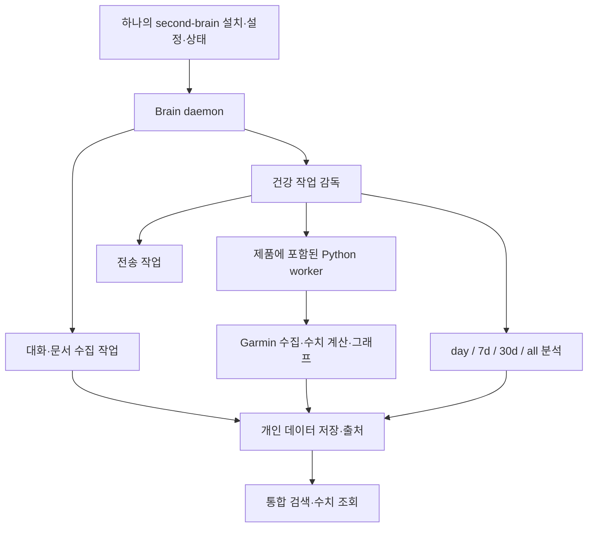

# second-brain에 Garmin을 흡수하는 단일 제품 통합안

**결론: 하나의 제품으로 흡수할 수 있으며, 운동·수면·체성분을 개인 장기기억으로 취급하는 방향에 구조적 장애는 없다.** second-brain이 설치·설정·데몬·예약·작업 상태·검색을 소유하고, Garmin의 검증된 Python 기능을 내부 건강 데이터 모듈로 편입하는 방식을 제안한다. TypeScript로 전부 재작성하는 것은 단일 제품의 필수 조건이 아니다.

이 문서는 코드 조사로부터 도출한 제안이다. 아래 “제안”은 현재 구현 상태가 아니다. 근거는 [second-brain 코드 조사](research-personal-data-runtime.md)와 [Garmin 코드 조사](garmin-runtime.md)에 커밋·파일·줄 단위로 기록했다. 애플리케이션 실행이나 실제 데이터 이전은 수행하지 않았다.

## 확정 방향과 이전 범위 — 2026-10-27 최종 정정

이 절은 사용자의 최신 설명을 반영하며, 이전 대화의 “기존 데이터 이전 제외” 판단을 대체한다.

- 하나의 제품과 하나의 주 DB를 사용하고 Garmin은 선택 설치 확장으로 제공한다.
- 주 DB는 OrbStack의 Docker에서 실행하는 PostgreSQL로 확정한다. 설치/운영 환경을 확정한 것이며, 아직 container를 생성하거나 실행하지 않았다.
- 지금까지 쌓인 원본·정규화/파생 수치·AI 분석 결과를 이전한다. 체성분 장부·완성 리포트 등 DB 밖 산출물도 실제 보존 대상 목록에 포함해 조사한다. 재계산 가능한 데이터도 검증 없이 버리지 않는다.
- 애플리케이션 설정을 DB에 저장한다. DB 접속에 필요한 bootstrap 정보는 별도 최소 설정으로 남는다.
- Telegram·Slack은 에이전트가 먼저 말을 걸고 사용자도 답하는 공통 대화 채널로 추가할 예정이다. 현재 구현된 기능이라는 뜻은 아니다.
- Drive는 미구현, 임베딩은 보류하고 텍스트 검색과 구조화된 건강 조회를 우선한다.
- 기존 Brain 설계는 SQLite 원본/Postgres 복제 대상이며, 이번 통합 PostgreSQL 설계는 아직 완성되지 않았다. 현재 문서는 통합 판단과 범위이며 완성된 ERD/DDL을 대신하지 않는다.

## 규모 판단과 남은 결정

데몬에서 기능을 호출하는 연결은 비교적 작다. 하나의 설치·상태·업데이트·개인 데이터·검색 체계로 완성하는 작업은 **중간 이상 규모의 통합 개발**이다. DB까지 같은 단계에서 합치거나 모든 Python을 TS로 옮기면 큰 개편이 된다. 이 평가는 구조와 변경 경계에 기반하며 일정 견적은 아니다.

현재 구현 범위는 완성된 검색/Drive 엔진보다 수집·저장·daemon 기반에 가깝다. 따라서 “건강 데이터까지 포함한 개인 장기기억”을 지금 제품 경계에 반영하는 것은 일관된 선택이다. 이 판단은 아직 구현되지 않은 검색·Drive까지 이미 완성되었다고 가정하지 않는다.

설계를 시작할 때 남은 것은 확장별 테이블/키 경계, 실제 데이터·파일의 이전 목록과 검증 계약, 채널 대화와 검색의 연결 방식이다. PostgreSQL 단일 주 저장소와 OrbStack Docker 사용은 확정됐다. 이 결정은 조사 진행의 승인 조건이 아니며, 다음 설계의 입력이다.

## 확인된 현실

| 영역 | 현재 구현 | 통합에 미치는 영향 |
|---|---|---|
| 데몬·작업 | 일감 등록/claim/재시도/실패/주기 실행 기반 존재 | 실행 기반을 재사용할 수 있다. |
| 작업 확장 | caller handlers를 주입 가능 | 건강 작업을 새 kind로 등록할 수 있다. 범용 plugin 자동 발견 구조가 이미 있다는 뜻은 아니다. |
| 처리 시간 | drain 안에서 handler 직렬 await, 데몬 예산10초는 작업 timeout 아님 | 리포트 전체를 한 handler에 넣으면 해당 drain의 대화 수집과 예약 다음 회차가 늦어진다. 별도 CLI drain까지 모두 멈춘다는 뜻은 아니다. |
| 임대 | 기본10분, scoped renewal 구현 미발견 | invocation 기본 timeout20분인 분석은 임대보다 오래 갈 수 있다. 다른 drain이 재획득할 경우 중복 실행을 다뤄야 한다. |
| 예약 | 실제 now+interval, 놓친 회차 합침 | 현재 Garmin의 현지 시각 매일 실행을 보존하려면 calendar/timezone 계약이 추가로 필요하다. |
| 개인 자료 | Claude Code 대화와 첨부, text 추출 | 독립 건강 데이터와 리포트 유입 API가 필요하다. 대화를 가짜로 만들어 끼우는 방식은 제안하지 않는다. |
| 검색·Drive | FTS schema와 포트는 있으나 공개 recall/Drive client 구현 미발견 | 완성된 지식 검색 제품에 Garmin만 꽂는 상태는 아니다. 개인 데이터 모델 확장과 검색 개발을 함께 맞출 수 있다. |
| DB | Brain schema9, Garmin migration0016; 각자 버전·락·migration 관리 | 같은 DB 경로를 주는 것만으로 합칠 수 없다. migration 소유권과 쓰기 경계를 먼저 정해야 한다. |
| Python 기능 | 인증/차단/원본/정규화/digest/평가/그래프/전송 계약 존재 | 그대로 편입할 자산이 많다. 숫자 계산·인증을 TS로 옮기는 일은 별도 비용이다. |
| 전달 | 알림 중복 gate는 한 번의 논리적 전송 시도; 리포트 재생성은 재전송 가능 | 작업 재시도와 발송 재시도를 동일하게 취급하면 누락/중복이 생길 수 있다. |

근거 대응: 첫 다섯 행은 Brain 조사 §1, 다음 두 행은 §2, DB는 Brain §2와 Garmin §저장, 나머지는 Garmin §수집·분석·전송에 해당한다. “미발견”은 조사한 커밋의 생산 코드와 공개 registry 범위에 한정한다.

## 제안하는 제품 경계

사용자는 second-brain 하나를 설치하고, 개인 데이터 소스에서 Garmin을 연결한다. Brain이 Python 환경, Garmin 자격 증명 위치, Codex 실행 환경과 skills, 예약, 진행 상태, 업데이트를 관리한다. 별도 Garmin 저장소 배포나 install-schedule을 사용자의 일상 운영 절차로 남기지 않는다.

이 그림은 목표 구조다. worker는 같은 제품의 내부 실행 단위다. “하나의 데몬”은 하나의 감독·운영 주체를 뜻하며, Python/Codex 자식 프로세스까지 같은 OS 프로세스로 실행해야 한다는 요구로 해석하지 않는다.

## 흡수할 모듈과 변경점

| 현재 자산/지점 | 유지할 동작 | 필요한 변경 제안 |
|---|---|---|
| Garmin adapter·collect | token/session lock, account block, 호출 간격, coverage와 raw 보존 | Brain 소스 연결/수동 수집/인증 필요 상태로 노출. 무인 일감에서 MFA를 기다리지 않는다. |
| normalize·digest·body | 원본에서 수치 재계산, 입력 출처, 날짜·시간대, 원자적 파일 교체 | 건강 도메인 모듈로 편입하고 표준 결과 계약을 정의한다. |
| report·CodexWriter | scope별 평가, schema 검증, subprocess 정리, skills | 분석 scope를 식별 가능한 작업으로 관리하고 취소·timeout·작업 임대를 연결한다. |
| charts·Telegram | 기존 출력과 실패 분류 | 그래프/전송을 분석과 구분된 후속 작업으로 추적한다. 재전송 요청은 명시적 작업으로 남긴다. |
| createBrain·drain·work policy | 원자적 claim/상태/재시도 | 건강 kind 등록, 장시간 작업 임대 갱신 또는 충분한 kind별 임대, 독립 실행 용량과 per-target 직렬화를 추가한다. |
| daemon run·control | heartbeat/소유권/시작·정지 | 처리 중 자식 작업의 종료 signal 전달·유예·강제종료·복구 계약을 검증한다. 현재 grace/control 전체를 조사한 것은 아니다. |
| schedule tick | atomic enqueue+next update | 현지 일자/시간대 예약과 놓친 실행 정책을 정의한다. 단순24시간 interval로11시 고정을 대신하지 않는다. |
| Brain data/store/migrations | 출처·원본·추출/파생 분리 | 소스·관측값·모델 평가·문서의 별도 타입과 독립 ingest/query API를 설계한다. |
| install/update | 하나의 제품 상태 | Python 런타임/의존성/skills를 버전 맞춰 설치하고, 활성 작업이 있는 업그레이드 정책을 정한다. |

### 긴 작업을 안전하게 관리하는 조건

현재 대기열에 `garmin_report` 하나를 추가해 전체 리포트를 await하는 것은 기능 연결의 실험으로는 가능하다. 제품 운영 구조로 확정하려면 대화 수집과 건강 분석이 서로의 처리 용량을 독점하지 않아야 한다. 선택지는 같은 데몬의 비동기 worker 감독 또는 제품 내부 worker process의 별도 claim 경로다. 동시성은 전체 무제한이 아니라 계정·일자·scope별로 제한한다.

긴 작업 동안 Brain DB transaction을 열어 두지 않는다. 외부 호출/분석은 transaction 밖에서 실행하고, 결과가 준비됐을 때 짧게 저장한다. 작업 identity 예시는 `소스/계정/대상일/scope/입력 revision`이며, 분석 완료와 전송 완료는 다른 상태로 다룬다. 열린 작업의 중복 억제와 외부 효과의 중복 억제는 서로 다른 보장이다.

Garmin의 기존 report lock은 중복 writer를 어느 정도 막지만, Brain claim의 만료·재획득·완료 상태 문제를 자동으로 해결하지 않는다. 날짜별 lock 하나만으로 전체 임대 갱신을 대신한다고 가정하지 않는다.

## 개인 장기기억의 데이터 모델

운동 데이터는 장기기억에 맞는다. 다만 검색용 문서와 정확한 수치를 각각 보존해야 한다. “당시 나는 어떻게 느꼈는가”는 대화, “실제로 무슨 운동을 했는가”는 측정·활동, “모델이 어떻게 해석했는가”는 평가로 연결한다.

제안 타입은 source/account, raw record, observation/activity, derived metric, model evaluation, report document다. 각 레코드에는 원본의 자연키, 사건 시각/현지 일자/시간대, 수집 시각, 입력 revision, 계산/모델 버전과 출처 연결을 둔다. 기존 Garmin raw가 모든 과거 revision을 보관하는 구조라는 뜻은 아니다. 통합 모델에서 필요한 revision 계약을 새로 정의하는 제안이다.

- “최근 운동 관련 대화와 리포트 찾아줘”: 문서·대화 recall 경로.
- “지난달 스쿼트 총 볼륨은?”: typed query와 검증된 계산 경로.
- “야근을 말한 날과 수면이 어땠어?”: 대화의 시각·출처와 건강 관측을 조합하는 경로. 검색된 동시 발생만으로 인과관계로 단정하지 않는다.

의미 검색에 모든 심박 샘플을 문장으로 바꿔 넣는 것을 기본 저장 방식으로 삼지 않는다. 원본·구조화값·서술을 연결하고, 질의에 따라 적절한 경로를 선택한다.

## PostgreSQL 통합 — 확정 환경과 남은 설계

주 저장소는 OrbStack Docker의 PostgreSQL 하나로 둔다. Brain이 migration을 소유하고 공통 기억/설정/작업/채널과 건강 확장 테이블의 경계를 정의해야 한다. 기존 Garmin SQL과 Brain의 초기 Postgres SQL을 단순 합치는 것으로 완료되지 않는다.

현재 Brain 아키텍처 AD-10은 SQLite를 원본, Postgres를 복제 대상으로 둔다. 이를 PostgreSQL 주 저장소로 바꾸고, SQLite의 최신 테이블/키 계약을 반영하며, 건강 데이터와 분석 출처를 연결하는 통합 설계가 필요하다. 기존 Postgres adapter는 health/schema 확인 수준이다.

기존 compose.test.yaml은 tmpfs를 사용하는 일회성 테스트 DB다. 보존할 데이터가 있는 제품 DB에는 별도의 compose와 persistent volume을 사용한다. 볼륨은 container 재생성 시 데이터를 유지하는 수단이며, 별도 backup/restore 검증도 이전 절차에 포함한다. 임베딩 보류 결정에 따라 pgvector를 제품 설치의 필수 의존성으로 삼지 않는다.

이전은 원본 DB/파일을 보존한 상태에서 PostgreSQL importer를 실행하고, 건수·자연키·날짜·실제 수치·분석 텍스트·출처 연결을 비교한 뒤 새 저장소를 사용한다. 같은 importer를 다시 실행해도 중복되지 않도록 한다. 에이전트가 작성한 분석은 재실행으로 대체하지 않고 기존 결과를 그대로 보존한다.

## 구현·이전 순서 제안

1. **제품 경계와 데이터 계약:** 건강 모듈을 같은 repo/install/update/config 아래 둘 범위를 확정하고, record identity·job result·출처·revision·조회 계약을 정의한다.
2. **데몬 실행 기반:** 긴 작업 감독, 임대, 취소/복구, 우선순위 또는 별도 용량, calendar 예약을 먼저 검증한다. fake worker로 crash·재획득·정지·업데이트 중단을 재현한다.
3. **건강 기능 편입:** 기존 Python 수집/정규화/분석/그래프를 제품 내부에 넣고 Brain이 환경과 실행을 관리한다. 같은 fixture의 수치·평가 입력·산출물을 기존 버전과 비교한다.
4. **저장·검색 연결:** typed health data와 report 문서를 source 기반으로 등록한다. 대화/문서 recall 개발과 건강 조회를 공통 검색 계약에 맞춘다. DB 단일화 여부에 따라 이 단계의 쓰기 경계를 결정한다.
5. **설정·기존 데이터 이전:** 원본 DB와 체성분/리포트 파일을 보존하고 원본·파생 수치·기존 AI 분석을 PostgreSQL로 가져온다. importer 재실행 멱등성과 값·출처 동등성을 검증한다. 설정도 공통/확장 계약으로 옮긴다.
6. **채널 연결:** 채널/대화방/스레드와 내부 대화 ID를 연결하고, 수신·발신·선제적 메시지·사용자 답변이 같은 기억 맥락으로 이어지게 한다. 기존 운영 예약 이전은 범위에서 제외한다.

이는 개발 순서 제안이며, 이번 조사에서 실행하거나 운영 예약을 변경하지 않았다.

## 검증 범위와 후속 확인

고정 커밋에서 read-only 정적 조사와 독립 주장 검증을 수행했다. 패키지 설치/빌드/테스트 실행/실제 migration은 하지 않았다. 로컬 Node는24.17.0이며 pnpm은 PATH에서 발견되지 않았다. 따라서 전체 suite가 통과한다고 보고하지 않는다.

후속 설계는 현재 조사 결과를 입력으로 삼아 단일 제품 경계, 저장 포트, 긴 작업 수명과 데이터 이전 계약을 구체화하면 된다. 설치된 BMad 흐름에서는 architecture가 이 결정들을 기록하는 다음 단계다. 소스 커밋이 바뀌면 문서의 anchor 검증과 부재 검색을 다시 수행해야 한다.
